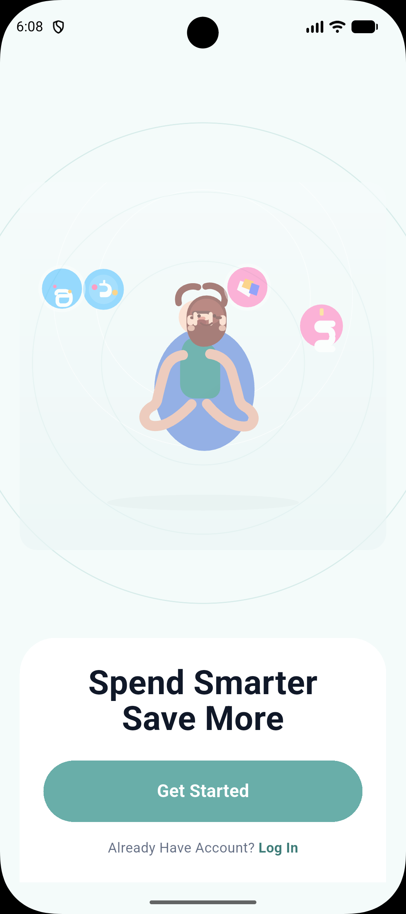
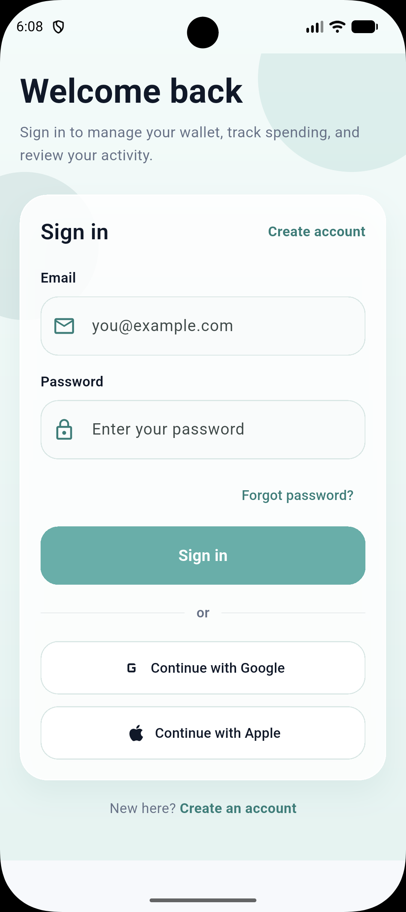
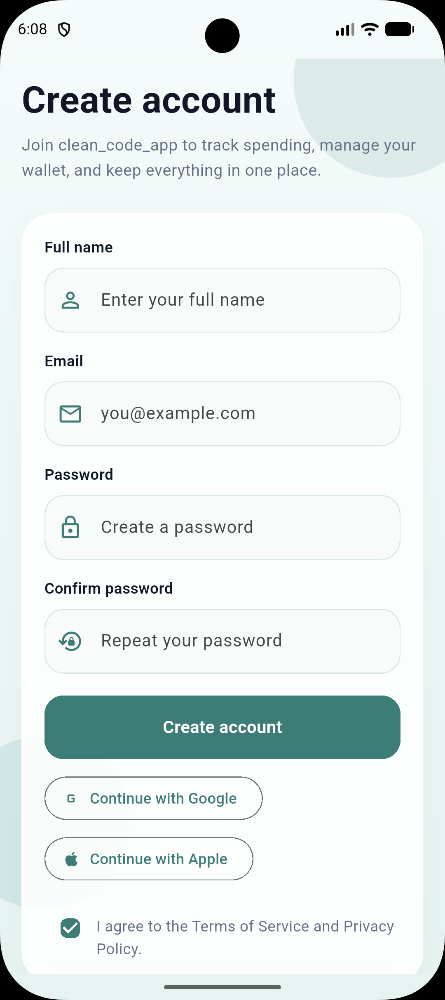
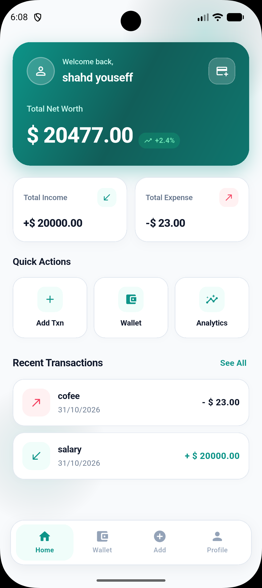
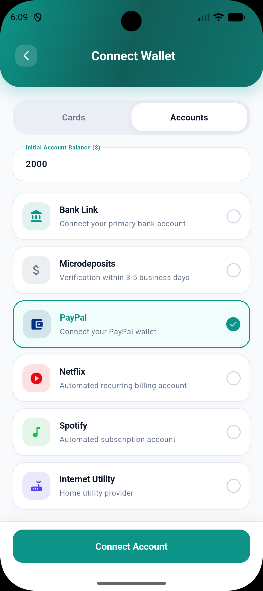
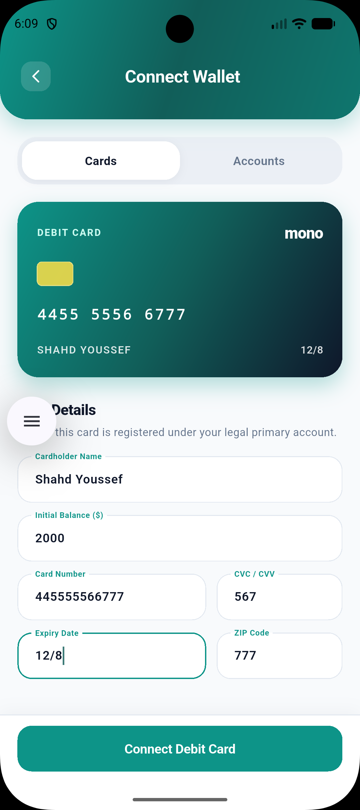
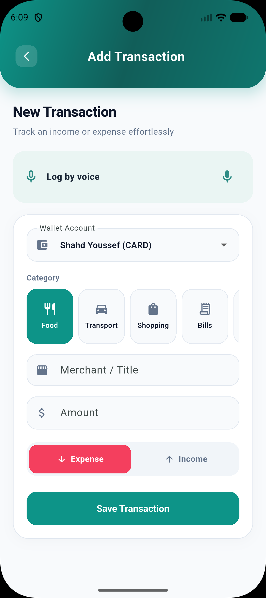
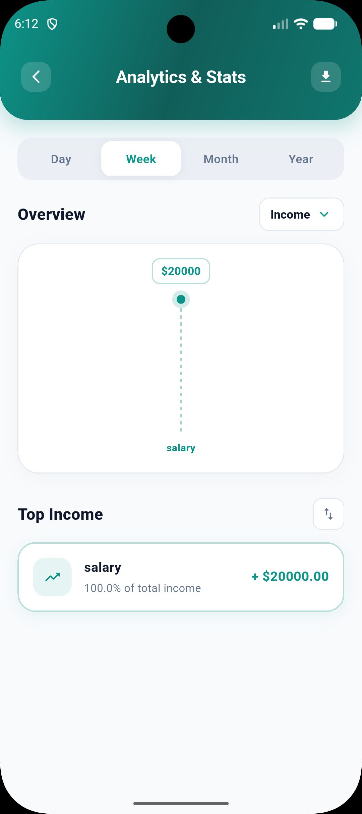
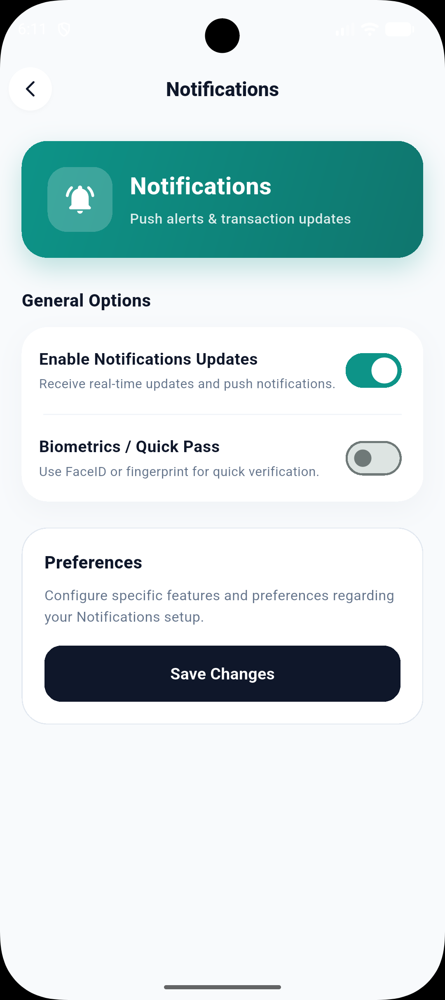
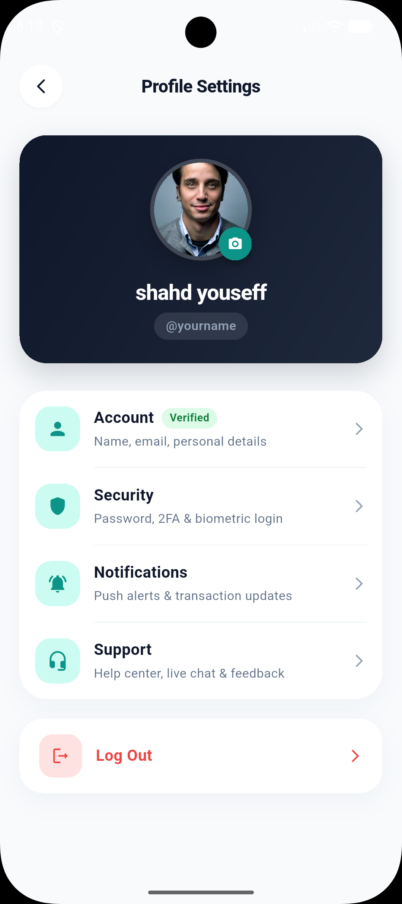

# 💰 Mono Wallet – Personal Finance & Expense Tracker

**Mono Wallet** is a Flutter-based personal finance application that helps users manage their wallet accounts, track income and expenses, monitor bills, and analyze their spending habits.

Built with **Flutter, Dart, and Supabase**, the application follows a feature-based architecture with Clean Architecture principles and BLoC/Cubit state management.

It also introduces an AI-powered voice transaction feature that allows users to describe financial activities in Arabic or English and convert their speech into structured, editable transactions before saving.

---

## 📱 Application Screenshots

### Getting Started & Authentication

| Onboarding | Login | Sign In |
|:---:|:---:|:---:|
|  |  |  |

### Wallet Management

| Home Dashboard | Add Account | Add Card |
|:---:|:---:|:---:|
|  |  |  |

### Transactions & Statistics

| Add Transaction | Statistics | Notifications |
|:---:|:---:|:---:|
|  |  |  |

### Profile



---

## ✨ Features

### 🔐 Authentication & User Management

- User registration and login using email and password.
- Email confirmation messaging.
- Password reset functionality.
- Password update.
- Persistent authentication sessions.
- Logout functionality.
- Google OAuth entry point.
- Apple OAuth entry point.
- Supabase-backed user profiles.

### 💳 Wallet Management

- Create and manage wallet accounts.
- View individual wallet balances.
- Delete wallet accounts.
- Select a wallet when recording transactions.
- Track financial activities across wallet accounts.

### 💸 Transaction Management

- Record income and expenses.
- View transaction history.
- Delete transactions.
- Support multiple transactions in one operation.
- Database-backed wallet balance updates.
- Transaction loading, empty, and error states.

### 📊 Financial Statistics

- Analyze income and expenses.
- Group transactions by category.
- View category-based spending statistics.
- Aggregate transaction data.
- Normalize Arabic-Indic and Persian digits.

### 🧾 Bills Management

- Retrieve bills from Supabase.
- View bill details.
- Pay bills through a Supabase database function.
- Handle payment errors.
- Prevent duplicate bill payments through database-side validation.

### 🎙️ AI-Powered Voice Transactions

- Arabic and English speech recognition.
- Convert spoken financial activities into structured transactions.
- Gemini-powered expense parsing through a Supabase Edge Function.
- Support multiple transactions in one voice request.
- Support income and expense descriptions.
- Edit and review generated transactions before saving.
- Normalize Arabic-Indic and Persian numerals.
- Validate AI-generated transaction data.
- Handle invalid responses, network errors, rate limits, and authentication failures.

### 🎨 User Experience

- Flutter Material interface.
- Feature-based navigation.
- Authentication-aware application flow.
- Loading, empty, and error states.
- Arabic and English voice input support.

---

## 🛠️ Technology Stack

| Technology | Purpose |
|---|---|
| Flutter | Cross-platform application development |
| Dart | Programming language |
| Supabase Auth | User authentication |
| Supabase PostgreSQL | Database |
| Supabase Edge Functions | Server-side functionality |
| Gemini API | AI-powered expense parsing |
| BLoC / Cubit | State management |
| GoRouter | Application navigation |
| GetIt | Dependency injection |
| HTTP | API communication |
| Speech To Text | Voice recognition |
| Mocktail | Mocking in tests |
| Bloc Test | State management testing |
| Flutter Test | Unit and widget testing |

---

## 🏗️ Architecture

Mono Wallet uses a feature-based project structure and applies Clean Architecture principles where implemented.

### Project Structure

```text
lib/
│
├── core/
│   ├── constants/
│   ├── errors/
│   ├── network/
│   ├── routing/
│   ├── theme/
│   └── utils/
│
├── features/
│   │
│   ├── auth/
│   │   ├── data/
│   │   ├── domain/
│   │   └── presentation/
│   │
│   ├── bills/
│   │   ├── data/
│   │   └── presentation/
│   │
│   ├── home/
│   │   ├── data/
│   │   ├── domain/
│   │   └── presentation/
│   │
│   ├── onboarding/
│   │   └── presentation/
│   │
│   ├── profile/
│   │   ├── data/
│   │   ├── domain/
│   │   └── presentation/
│   │
│   ├── splash/
│   │   └── presentation/
│   │
│   ├── statistics/
│   │   ├── data/
│   │   ├── domain/
│   │   └── presentation/
│   │
│   ├── transactions/
│   │   ├── data/
│   │   └── presentation/
│   │
│   └── wallet/
│       ├── data/
│       ├── domain/
│       └── presentation/
│
├── main.dart
└── service_locator.dart
│
├── test/
├── supabase/
└── docs/
```

### Presentation Layer

Responsible for:

- Screens and UI components.
- Cubits and state management.
- User interactions.
- Loading, success, and error states.

### Domain Layer

Contains domain logic where implemented:

- Entities.
- Repository contracts.
- Use cases.

### Data Layer

Responsible for:

- Supabase repositories.
- Remote data sources.
- API services.
- Data conversion and validation.
- External service communication.

### State Management

BLoC/Cubit manages application state, including:

- Authentication.
- Wallet accounts.
- Transactions.
- Bills.
- User profiles.
- Statistics.

---

## 🤖 AI Voice Transaction Architecture

Mono Wallet integrates speech recognition and Gemini to simplify financial transaction entry.

### Voice Transaction Workflow

```text
User speaks in Arabic or English
              |
              v
       Speech Recognition
              |
              v
       Transcript Text
              |
              v
      Number Normalization
              |
              v
   Authenticated Supabase Request
              |
              v
       Supabase Edge Function
              |
              v
           Gemini API
              |
              v
    Structured Transaction JSON
              |
              v
       Response Validation
              |
              v
       Editable Confirmation
              |
              v
        User Confirmation
              |
              v
       Save to Selected Wallet
```

### Security

The Gemini API key is designed to remain on the server side.

- Flutter sends the transcript to the authenticated Edge Function.
- The Edge Function retrieves the Gemini API key from Supabase Function Secrets.
- The Gemini key is never embedded in the Flutter application.
- The user reviews and confirms generated transactions before saving.

---

## 🗄️ Database

The Flutter client currently interacts with the following Supabase tables:

| Table | Purpose |
|---|---|
| `profiles` | User profile information |
| `accounts` | Wallet accounts |
| `transactions` | Income and expense records |
| `categories` | Transaction categories |
| `bills` | User bills and payment information |

### Database Functions

The application calls the following database functions:

- `create_wallet_transactions`
- `pay_wallet_bill`
- `delete_wallet_transaction`

These functions are intended to handle database-side financial operations and ownership validation.

**Important:** The production database schema, foreign keys, triggers, and RLS policies must be verified in the Supabase dashboard. They are not fully represented by versioned migrations in this repository.

### Row Level Security (RLS)

Every user-owned table should enforce authenticated ownership.

The intended policy pattern is:

```sql
USING (auth.uid() = user_id)
WITH CHECK (auth.uid() = user_id);
```

The actual ownership column must be confirmed against the live schema.

Database functions must independently validate ownership rather than relying only on Flutter-side checks.

---

## 🔒 Security Considerations

Security is an important part of Mono Wallet's backend design.

- Supabase authentication identifies application users.
- User-owned records require Row Level Security.
- Gemini requests are designed to run through authenticated Edge Functions.
- Sensitive API keys belong in server-side secrets.
- Database operations must validate user ownership.
- Financial transaction operations should maintain wallet balance integrity.
- Transaction deletion must account for existing database triggers to prevent duplicate balance adjustments.

Never commit:

- Supabase service-role keys.
- Gemini API keys.
- OAuth client secrets.
- Google service account credentials.
- Android signing keys.
- iOS signing certificates.
- Private environment files.

The Supabase publishable key can be used in a client application when the database is correctly protected by RLS.

---

## 🚀 Getting Started

### Prerequisites

Install the following tools:

- Flutter SDK.
- Dart SDK included with Flutter.
- Android Studio and Android SDK.
- Xcode for iOS development.
- CocoaPods for iOS dependencies.
- A Supabase account and project.
- Supabase CLI for backend deployment.

Required Dart SDK:

```text
>=3.11.4 <4.0.0
```

### 1. Clone the Repository

```bash
git clone https://github.com/shahdhagag/mono-wallet.git
```

### 2. Navigate to the Project

```bash
cd mono-wallet
```

### 3. Install Dependencies

```bash
flutter pub get
```

### 4. Configure Supabase

Configure the Supabase project URL and publishable key in the application configuration.

Currently, these values are configured in:

```text
lib/main.dart
```

Ensure that:

- Supabase Auth is enabled.
- Required database tables exist.
- Database functions are configured.
- RLS policies protect user-owned records.
- Authentication redirect URLs are configured.

Never include service-role keys or private API credentials in Flutter source code.

### 5. Run the Application

List available devices:

```bash
flutter devices
```

Run the application:

```bash
flutter run
```

To run on a specific device:

```bash
flutter run -d <device-id>
```

---

## 🧪 Testing

Run all tests:

```bash
flutter test
```

The latest recorded local test result is:

**17 tests passed.**

The test suite covers:

- Bill payment success.
- Duplicate bill payment prevention.
- Bill payment errors.
- Arabic-Indic digit normalization.
- Persian digit normalization.
- Gemini response parsing.
- Invalid Gemini response handling.
- Edge Function response parsing.
- Profile updates.
- Statistics aggregation.
- Category-based statistics.
- Transaction loading.
- Transaction creation.
- Transaction deletion success.
- Transaction deletion failure.
- Widget startup behavior.

Tests use mocks and fakes for external services and do not require production Supabase or Gemini credentials.

### Static Analysis

Run:

```bash
flutter analyze
```

The latest recorded result contains no compilation errors and four informational findings related to unnecessary multiple underscores in existing callbacks.

---

## 📦 Building the Application

### Android Debug APK

```bash
flutter build apk --debug
```

The Android debug APK has been built successfully.

### Android Release App Bundle

```bash
flutter build appbundle --release
```

Release build verification is pending.

Previous local release attempts terminated during Dart AOT snapshot generation with exit code `-9`, indicating a local resource or process termination issue.

A successful release build is required before claiming Android release readiness.

### iOS Simulator

```bash
flutter build ios --simulator
```

The local simulator build requires further Flutter/Xcode architecture troubleshooting.

Useful diagnostic commands:

```bash
flutter doctor -v
xcode-select -p
xcodebuild -version
flutter precache --ios
```

Then retry:

```bash
flutter clean
flutter pub get
flutter build ios --simulator
```

---

## 🔑 Authentication Provider Configuration

### Email Authentication

Configure the following in Supabase:

- Email provider.
- Email confirmation behavior.
- Password reset redirect URL.
- Site URL.
- Allowed redirect URLs.

Application callback:

```text
mono-wallet://auth-callback
```

### Google OAuth

The application contains a Google OAuth entry point.

Additional configuration is required:

- Google Cloud OAuth client.
- Supabase Google provider.
- Redirect URI.
- Android package name and SHA fingerprints.
- iOS bundle identifier.
- Web client configuration if required.

Google OAuth is not claimed as production-verified.

### Apple OAuth

The application contains an Apple OAuth entry point.

Additional configuration is required:

- Apple Developer identifier.
- Service ID.
- Authentication key.
- Team ID.
- Client ID.
- Redirect URI.
- Supabase Apple provider.

Apple authentication remains optional until configuration and testing are complete.

---

## 🧾 Bills & Payments

Bills are retrieved from Supabase using the authenticated user context.

Bill payment uses:

```text
pay_wallet_bill
```

The database function is expected to validate:

- Bill ownership.
- Account ownership.
- Bill amount.
- Payment state.
- Duplicate payment prevention.

Mono Wallet does not currently claim integration with an external payment gateway.

---

## 📌 Current Project Status

| Component | Status |
|---|---|
| Flutter application | Implemented |
| Email authentication | Implemented |
| Wallet management | Implemented |
| Transaction management | Implemented |
| Bills management | Implemented |
| Statistics aggregation | Implemented |
| Arabic and English voice recognition | Implemented |
| Gemini parsing integration | Prepared, deployment pending |
| Atomic transaction deletion RPC | Prepared, deployment pending |
| Supabase production schema verification | Pending |
| RLS verification | Pending |
| Google OAuth | Configuration pending |
| Apple OAuth | Configuration pending |
| Android debug build | Verified |
| Android release build | Pending |
| iOS simulator build | Troubleshooting required |
| Automated tests | 17 passing in latest recorded run |
| GitHub screenshots | Added |

---

## ⚠️ Known Limitations

- Production database schema and RLS policies require live-project verification.
- The atomic transaction deletion migration has not been deployed.
- The Gemini Edge Function has been prepared locally but deployment is pending.
- Google and Apple OAuth require additional provider configuration.
- Some legacy/sample data sources remain and should be replaced with authenticated repositories.
- Statistics date-period filtering requires further verification.
- Android release AOT generation requires troubleshooting.
- iOS simulator architecture validation requires troubleshooting.
- Integration tests with an isolated Supabase test environment are not yet complete.
- No open-source license has been selected.

---

## 🔮 Future Improvements

- Complete Supabase production deployment.
- Deploy and verify the Gemini Edge Function.
- Deploy and test the atomic transaction deletion RPC.
- Add versioned Supabase migrations.
- Add automated RLS and database integration tests.
- Replace remaining legacy sample repositories.
- Improve financial statistics with date filtering.
- Add OAuth integration tests.
- Add deep-link integration tests.
- Add speech permission integration tests.
- Resolve Android release build issues.
- Resolve iOS simulator build issues.
- Expand financial insights and analytics.

---

## 📂 Additional Documentation

Additional project documentation is available in:

```text
docs/
├── mono_wallet_guide.md
├── mono_wallet_guide1.md
└── supabase_security_proposal.md
```

These documents provide additional technical guidance and security planning.

---

## 👩‍💻 Author

**Shahd Ahmed Youssef**

Software Engineer | Flutter Developer

- GitHub: [@shahdhagag](https://github.com/shahdhagag)
- LinkedIn: [Shahd Ahmed](https://www.linkedin.com/in/shahd-ahmed-87a716296)

---

## 📄 License

No open-source license has been selected yet.

