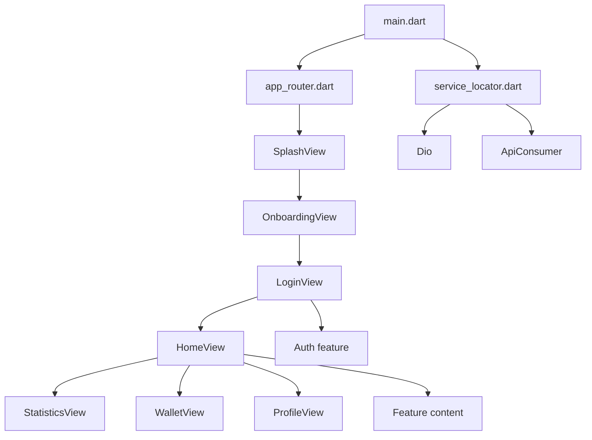

# Mono Wallet Full Architecture and Code Guide

This document explains the current app architecture, the role of each file, and how the main code paths work together.

## 1. Big Picture

Mono Wallet is organized with a clean architecture style. The app is split into layers so each part has one job.

The main layers are:

- `core` for shared app-wide code
- `features` for user-facing screens and feature logic
- `service_locator.dart` for dependency injection
- `main.dart` for bootstrapping the app

This gives the app these benefits:

- UI code stays separate from business logic
- network code stays separate from screens
- features can grow without turning the whole app into one large file
- testing becomes easier because implementations can be swapped later

## 2. Startup Flow

The app launches in this order:

1. `main.dart` starts Flutter and registers services.
2. `MaterialApp.router` loads the router configuration.
3. The router opens the splash screen first.
4. Splash automatically navigates to onboarding.
5. Onboarding takes the user to login.
6. Login goes to the home shell.
7. Home contains the bottom navigation tabs.

This means the user always sees a branded animated entry flow before reaching the main app.

## 3. Architecture Diagram



## 4. `main.dart`

File: [lib/main.dart](../lib/main.dart)

```dart
void main() {
  WidgetsFlutterBinding.ensureInitialized();
  setupServiceLocator();
  runApp(const MonoWalletApp());
}
```

### What this code does

- `WidgetsFlutterBinding.ensureInitialized()` prepares Flutter before anything async or platform-based happens.
- `setupServiceLocator()` registers shared dependencies.
- `runApp()` launches the root widget.

### `MonoWalletApp`

This is the root widget.

```dart
return MaterialApp.router(
  debugShowCheckedModeBanner: false,
  title: 'Mono Wallet',
  theme: AppTheme.lightTheme,
  routerConfig: appRouter,
);
```

### Why this is important

- `MaterialApp.router` means navigation is controlled by `go_router`.
- `AppTheme.lightTheme` keeps styling centralized.
- `appRouter` decides which screen opens first and how navigation behaves.

## 5. Router Setup

File: [lib/core/routing/app_router.dart](../lib/core/routing/app_router.dart)

The router is the navigation map of the app.

### Current routes

- `/splash` -> splash screen
- `/onboarding` -> onboarding screen
- `/login` -> login screen
- `/home` -> home shell

### Important behavior

The router starts at `/splash`.

```dart
final GoRouter appRouter = GoRouter(
  initialLocation: '/splash',
```

The root path `/` redirects to splash.

```dart
GoRoute(
  path: '/',
  redirect: (context, state) => '/splash',
),
```

### Why this matters

- The first screen is always the splash screen.
- The app flow is predictable.
- You do not need to manually push the first screen.

## 6. Dependency Injection

File: [lib/service_locator.dart](../lib/service_locator.dart)

This file uses `get_it`.

### What is registered

- `Dio` as the HTTP client
- `ApiConsumer` as an abstraction around network calls

### Why this exists

- `Dio` is only created once
- dependencies can be accessed anywhere without passing them through every constructor manually
- later, real repositories and use cases can be added cleanly

### Code meaning

```dart
serviceLocator.registerLazySingleton<Dio>(
  () => Dio(
    BaseOptions(...),
  ),
);
```

This means the app creates `Dio` only when it is needed for the first time.

## 7. Core Layer

The `core` folder contains shared code used by multiple features.

### 7.1 Colors

File: [lib/core/constants/app_colors.dart](../lib/core/constants/app_colors.dart)

This file stores the brand colors.

Current brand colors:

- Primary: `#3E7C78`
- Secondary: `#69AEA9`

Other shared colors:

- `background`
- `surface`
- `textPrimary`
- `textSecondary`
- `success`
- `warning`
- `danger`

### Why this file matters

- all screens use the same color palette
- if the brand changes, you update one file
- it keeps the design consistent

### 7.2 Styles

File: [lib/core/constants/app_styles.dart](../lib/core/constants/app_styles.dart)

This file stores reusable text styles.

It defines:

- `headingLarge`
- `headingMedium`
- `body`

### Why this file matters

- you do not repeat the same text style everywhere
- typography stays consistent
- UI code becomes shorter and easier to read

### 7.3 Theme

File: [lib/core/theme/app_theme.dart](../lib/core/theme/app_theme.dart)

This file defines the global app theme.

### What it configures

- `ColorScheme.fromSeed`
- `scaffoldBackgroundColor`
- `AppBarTheme`
- `TextTheme`

### Why it matters

- the whole app inherits the same Material 3 styling
- the UI looks unified across screens
- future widgets automatically match the app’s look

### 7.4 Network

File: [lib/core/network/api_consumer.dart](../lib/core/network/api_consumer.dart)

This file wraps `Dio` behind an interface.

### Parts of the file

- `ApiConsumer` is the abstract contract
- `DioApiConsumer` is the implementation

### Why this matters

- features do not need to know the details of `Dio`
- the network layer becomes replaceable
- testing becomes easier because you can mock the interface

### 7.5 Errors

Files:

- [lib/core/errors/exceptions.dart](../lib/core/errors/exceptions.dart)
- [lib/core/errors/failures.dart](../lib/core/errors/failures.dart)

These files are the standard place for app-wide error types.

### `exceptions.dart`

- `ServerException`
- `CacheException`

These are for technical failures thrown by data sources.

### `failures.dart`

- `Failure`
- `ServerFailure`
- `CacheFailure`

These are the domain-friendly error types that can be returned to the UI layer later.

### Why this matters

- technical errors and user-facing failures are separated
- the domain layer does not depend on raw exceptions

### 7.6 Helpers

File: [lib/core/utils/helpers.dart](../lib/core/utils/helpers.dart)

This file contains simple extension helpers.

### `ContextHelpers`

- `appTheme`
- `colors`
- `showAppSnackBar()`

### `StringHelpers`

- `isNotBlank`
- `capitalized`

### Why this matters

- repeated utility code moves out of the screens
- UI code stays cleaner

## 8. Splash Screen

File: [lib/features/splash/presentation/views/splash_view.dart](../lib/features/splash/presentation/views/splash_view.dart)

The splash screen is the first visual screen of the app.

### What it shows

- a teal gradient background
- subtle background texture dots
- the centered word `mono`
- pulsing fade/scale animation
- animated loading dots near the bottom

### Code breakdown

#### `SplashView`

This is a `StatefulWidget` because it needs animation and delayed navigation.

#### `_SplashViewState`

This state:

- creates animation controllers
- starts a timer
- navigates to onboarding after 2 seconds

#### `_controller`

This drives the logo pulse animation.

#### `_scaleAnimation`

This slightly grows and shrinks the logo.

#### `_fadeAnimation`

This changes the opacity so the logo breathes softly.

#### `_navigationTimer`

This waits 2 seconds, then calls `context.go('/onboarding')`.

#### `_LoadingDots`

This widget shows three small circles that pulse in sequence.

#### `_SplashTexturePainter`

This custom painter draws small white circles across the background to create texture.

### Why this screen exists

- it gives the app a branded opening moment
- it hides any startup delay
- it transitions naturally into onboarding

## 9. Onboarding Screen

File: [lib/features/onboarding/presentation/views/onboarding_view.dart](../lib/features/onboarding/presentation/views/onboarding_view.dart)

The onboarding screen is the introduction/marketing screen.

### What it shows

- a large SVG hero image
- the title `Spend Smarter / Save More`
- a `Get Started` button
- a `Log In` text link
- a soft animated card and illustration movement

### Code breakdown

#### `OnboardingView`

This is a `StatefulWidget` because the hero image animates.

#### `_OnboardingViewState`

This state handles the animation controller and screen layout.

#### `_controller`

This creates a repeating animation for the entrance and floating motion.

#### `_fadeAnimation`

This fades the hero illustration in smoothly.

#### `_slideAnimation`

This slides the hero slightly upward into place.

#### `HeroIllustration`

This widget loads the SVG asset with `SvgPicture.asset`.

#### `_RingPainter`

This draws the light circular rings in the background.

### Button behavior

- `Get Started` goes to `/login`
- `Log In` also goes to `/login`

### Why this screen exists

- it explains the app value before sign-in
- it makes the app feel polished and modern
- it gives the user a clear next step

## 10. Onboarding Asset

File: [assets/illustrations/onboarding_hero.svg](../assets/illustrations/onboarding_hero.svg)

This is the local SVG image used in onboarding.

### What the asset does

- shows a friendly finance-themed character
- keeps the image sharp on all screen sizes
- supports the full onboarding design

### Why SVG was chosen

- it scales well
- it stays crisp
- it is good for lightweight illustrations

### Asset registration

The asset is listed in `pubspec.yaml` so Flutter bundles it into the app.

## 11. Login Screen

File: [lib/features/auth/presentation/views/login_view.dart](../lib/features/auth/presentation/views/login_view.dart)

This is the login UI.

### What it shows

- welcome headline
- description text
- email field
- password field
- reusable primary button

### Current behavior

- the button is a placeholder and routes to `/home`

### Why it exists

- it separates authentication from the main app shell
- it gives a place to connect real sign-in logic later

## 12. Auth Feature Structure

Files:

- [lib/features/auth/domain/entities/user.dart](../lib/features/auth/domain/entities/user.dart)
- [lib/features/auth/domain/repositories/auth_repository.dart](../lib/features/auth/domain/repositories/auth_repository.dart)
- [lib/features/auth/domain/usecases/sign_in_usecase.dart](../lib/features/auth/domain/usecases/sign_in_usecase.dart)
- [lib/features/auth/data/datasources/auth_local_data_source.dart](../lib/features/auth/data/datasources/auth_local_data_source.dart)
- [lib/features/auth/data/datasources/auth_remote_data_source.dart](../lib/features/auth/data/datasources/auth_remote_data_source.dart)
- [lib/features/auth/data/models/user_model.dart](../lib/features/auth/data/models/user_model.dart)
- [lib/features/auth/data/repositories/auth_repository_impl.dart](../lib/features/auth/data/repositories/auth_repository_impl.dart)
- [lib/features/auth/presentation/cubit/auth_state.dart](../lib/features/auth/presentation/cubit/auth_state.dart)
- [lib/features/auth/presentation/cubit/auth_cubit.dart](../lib/features/auth/presentation/cubit/auth_cubit.dart)
- [lib/features/auth/presentation/widgets/auth_primary_button.dart](../lib/features/auth/presentation/widgets/auth_primary_button.dart)

### How the layer split works

#### Domain

Domain contains the pure business definitions.

- `User` is the user entity
- `AuthRepository` is the abstract contract
- `SignInUseCase` calls the repository

#### Data

Data contains the technical implementation.

- `AuthRemoteDataSource` simulates a remote sign-in call
- `AuthLocalDataSource` simulates token storage
- `UserModel` converts JSON to and from a domain entity
- `AuthRepositoryImpl` connects the data layer to the domain contract

#### Presentation

Presentation contains UI and state.

- `AuthCubit` manages auth state
- `AuthState` defines the possible states
- `AuthPrimaryButton` is a reusable UI button

### Why this architecture matters

- UI does not know backend details
- business rules do not depend on Flutter widgets
- implementation can be changed without rewriting the screen

## 13. Home Screen

File: [lib/features/home/presentation/views/home_view.dart](../lib/features/home/presentation/views/home_view.dart)

This is the main app shell after login.

### What it does

- shows the bottom navigation bar
- keeps tab state with `IndexedStack`
- loads four main sections

### Tabs

- Home dashboard
- Statistics
- Wallet
- Profile

### Why `IndexedStack` is used

- tabs stay alive when switching
- state is not lost between tabs
- it feels smoother than rebuilding every tab from zero

### Home dashboard content

The dashboard tab contains:

- summary card with balance
- quick actions
- recent activity items

### Why this screen exists

- it is the main landing page after sign-in
- it collects the most important wallet actions in one place

## 14. Statistics Page

File: [lib/features/statistics/presentation/views/statistics_view.dart](../lib/features/statistics/presentation/views/statistics_view.dart)

This page is for spending analysis.

### Current content

- page title
- short description
- monthly overview card
- category rows

### Why it exists

- it gives a dedicated place for charts and analytics later
- it separates insights from the main dashboard

## 15. Wallet Page

File: [lib/features/wallet/presentation/views/wallet_view.dart](../lib/features/wallet/presentation/views/wallet_view.dart)

This page is for wallet balances.

### Current content

- page title
- short description
- main wallet card
- savings card

### Why it exists

- it is a dedicated area for balances and payment-related info
- it can later hold cards, bills, transfers, and top-up actions

## 16. Profile Page

File: [lib/features/profile/presentation/views/profile_view.dart](../lib/features/profile/presentation/views/profile_view.dart)

This page is for profile/account information.

### Current content

- page title
- description
- avatar row
- name and email

### Why it exists

- it gives a place for settings
- it can later hold security, preferences, and support

## 17. Other Feature Layers

The repository already contains clean-architecture structure for the following features:

- `home`
- `statistics`
- `wallet`
- `profile`

Each feature follows the same pattern:

- `domain`
- `data`
- `presentation`

This consistency is important because it keeps the codebase understandable as it grows.

## 18. Reusable UI Pieces

File: [lib/features/auth/presentation/widgets/auth_primary_button.dart](../lib/features/auth/presentation/widgets/auth_primary_button.dart)

This button widget is reusable in auth screens.

### Why it exists

- keeps button styling consistent
- avoids duplicating the same button markup

## 19. Validation

The project has already been validated with:

- `flutter analyze`
- `flutter test test/widget_test.dart`

Both currently pass.

## 20. Current Flow Summary

1. App starts.
2. Splash appears first.
3. Splash animates and moves to onboarding.
4. Onboarding shows the hero image and CTA.
5. Login is the next auth step.
6. Home is the main app shell.
7. Home tabs show dashboard, stats, wallet, and profile.

## 21. Current File Map

Important files currently in the app:

- [lib/main.dart](../lib/main.dart)
- [lib/service_locator.dart](../lib/service_locator.dart)
- [lib/core/routing/app_router.dart](../lib/core/routing/app_router.dart)
- [lib/core/theme/app_theme.dart](../lib/core/theme/app_theme.dart)
- [lib/core/constants/app_colors.dart](../lib/core/constants/app_colors.dart)
- [lib/core/constants/app_styles.dart](../lib/core/constants/app_styles.dart)
- [lib/core/network/api_consumer.dart](../lib/core/network/api_consumer.dart)
- [lib/core/utils/helpers.dart](../lib/core/utils/helpers.dart)
- [lib/features/splash/presentation/views/splash_view.dart](../lib/features/splash/presentation/views/splash_view.dart)
- [lib/features/onboarding/presentation/views/onboarding_view.dart](../lib/features/onboarding/presentation/views/onboarding_view.dart)
- [lib/features/auth/presentation/views/login_view.dart](../lib/features/auth/presentation/views/login_view.dart)
- [lib/features/home/presentation/views/home_view.dart](../lib/features/home/presentation/views/home_view.dart)
- [lib/features/statistics/presentation/views/statistics_view.dart](../lib/features/statistics/presentation/views/statistics_view.dart)
- [lib/features/wallet/presentation/views/wallet_view.dart](../lib/features/wallet/presentation/views/wallet_view.dart)
- [lib/features/profile/presentation/views/profile_view.dart](../lib/features/profile/presentation/views/profile_view.dart)
- [assets/illustrations/onboarding_hero.svg](../assets/illustrations/onboarding_hero.svg)
- [pubspec.yaml](../pubspec.yaml)

## 22. Notes on the Architecture

The architecture is intentionally simple right now, but it is already set up the right way.

- `core` holds the app-wide building blocks.
- `features` hold the business modules.
- `domain` owns the rules and contracts.
- `data` owns the implementation details.
- `presentation` owns the UI and state.

That is the main clean architecture idea in this project.

## 23. What Is Still Mocked

Some pieces are placeholders for now:

- auth data source
- local auth caching
- home/statistics/wallet/profile repositories and use cases

This is normal at the scaffold stage. The structure is ready for real API integration later.